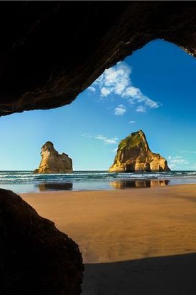
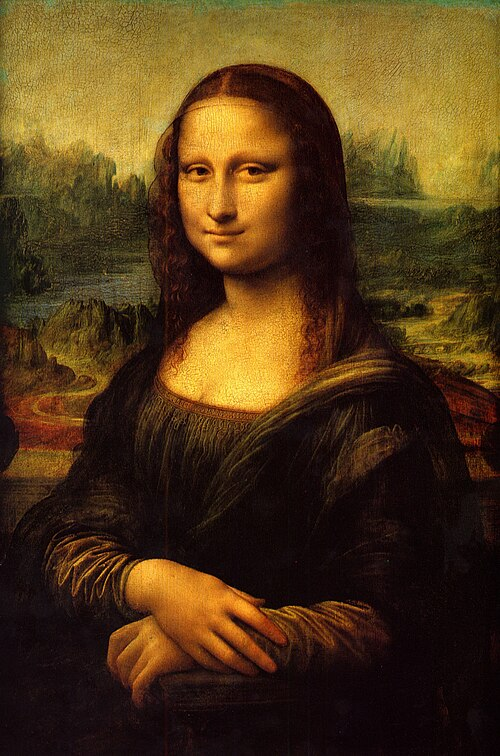
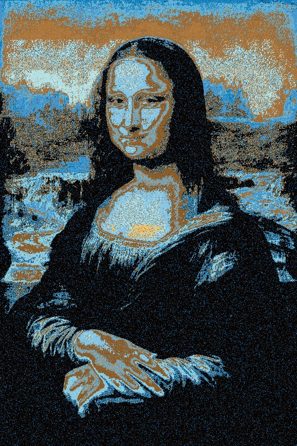
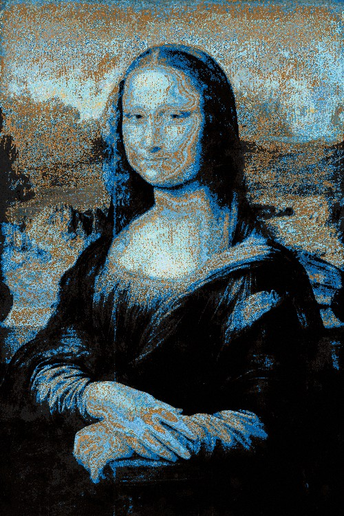

# Image-Reorganizer

A C++ image processing tool that reorganizes pixels from an initial image to match the appearance of a target image, outputting a final image alongside an MPEG animation of the transition.

## Features

- Adjustable image aspect ratio, resolution, and scale factor
- Adjustable pixel reorganization match factor (bucket error threshold using a RedMean Difference)
- MPEG video generation showing smooth pixel movement
- Multi-threaded processing with progress reporting

## Requirements

- **Compiler:** C++17 compliant compiler (e.g., `g++` or `clang++`)
- **Build Tool:** `make`

## Build

Navigate to the directory containing the source code and `Makefile`.

Compile the project:
```bash
make
```

Remove intermediate build files (`.o`, `.d`) and binary targets:
```bash
make clean
```

> **Note:** Standard `make` automatically tracks file changes and only recompiles modified files.

## Usage

```bash
./imageReorganizer.exe <image1_path> <image2_path> <output_basename> [-d scale_or_widthXheight] [-b allowed_error_percentage]
```

### Options

| Flag | Description | Default |
| --- | --- | --- |
| `-d` | Target resolution (`WIDTHxHEIGHT`) or scaling factor (e.g., `0.75`). | Aspect ratio of `image1` (capped at 524,288 pixels via `definitions.h/MAX_PIX_COUNT`). |
| `-b` | Allowed bucket error percentage. How far pixels are allowed to be from each other per the RedMean Difference (e.g., `0.05` for 5%). Lower numbers result in higher definition of curves and shadows. | `0.03` (3% threshold via `definitions.cpp/MAX_BUCKET_ERROR` (For example a 3% is:  #a1b481 & #a1b073. 10% is:  #a1b481 & #7ab865)). |


### Examples

**Default Run:**
Matches `image1`'s aspect ratio and sets bucket error to 3%.
```bash
./imageReorganizer.exe input1.jpg input2.jpg output
```

**Explicit Resolution:**
```bash
./imageReorganizer.exe input1.jpg input2.jpg output -d 640x480
```

**Scale Percentage:**
```bash
./imageReorganizer.exe input1.jpg input2.jpg output -d 0.75
```

**Custom Bucket Error (5%):**
```bash
./imageReorganizer.exe input1.jpg input2.jpg output -b 0.05
```

### Visual Examples

Reconstructing the **Mona Lisa** using pixels extracted from the **Windows Ocean Background**:

| Source Image | Target Image |
| :---: | :---: |
|  |  |

| **Looser Match Threshold means Faster Runtime (`-b 0.1` / 10% Error):** | **Tighter Match Threshold means Finer Details (`-b 0.03` / 3% Error):** |
| :---: | :---: |
|  | 


### Output Files

- `<output_basename>.jpg` — The processed target image constructed from source pixels.
- `<output_basename>.mpg` — An MPEG video animation depicting pixel movement over time.

> **Note on Video Playback:** Some default system players (e.g., default Windows Media Player) may lack codecs required to play the generated `.mpg` files out of the box. Use a modern player such as [VLC Media Player](https://www.videolan.org/vlc/) if playback fails.